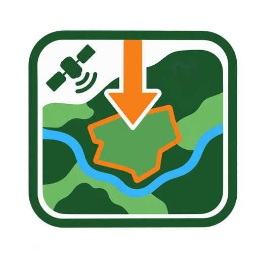

<p align="center"></p>

# GEE Image Downloader

QGIS plugin that downloads **Landsat**, **Sentinel-2** and **MapBiomas** imagery from
[Google Earth Engine](https://earthengine.google.com/) straight into QGIS, including **multi-year time
series** (for example 1995 to today). Each image is saved as a GeoTIFF
in a folder you choose and opened in the project.

## What it does

1. **Area**: pick a polygon layer (or only the selected features).
2. **What to download**:
   - *One date*, with a check that tells you whether an image exists and lists nearby dates;
   - *Best image of a year*: the plugin scores every date by the fraction of clear pixels over your area
     and downloads the clearest one (you can also pick a date from the table);
   - *Series of years*: one best image per year, loaded as a group of layers (newest on top).
3. **Download**: progress bar, cancel button, and the option to skip images already in the folder so a long
   series can be resumed.

Imagery:

| Source | Years | Resolution | Composite (SWIR1-NIR-Blue) |
| --- | --- | --- | --- |
| Landsat 4/5 | up to 2012 | 30 m | bands 5-4-1 |
| Landsat 8/9 | 2013 to today | 30 m | bands 6-5-2 |
| Sentinel-2 | 2017 to today | 10 m | bands 11-8-2 |
| MapBiomas Brazil (beta) | 1985 to latest collection | 30 m | class raster |

"Automatic by year" uses Landsat 4/5 up to 2012 and Landsat 8/9 from 2013. From 2017 it first looks for a
Sentinel-2 image of the year that is clean and complete over your area (at least 95% clear, adjustable in the
advanced options, and fully covered); if there is none, it uses the clearest Landsat of the year. The log shows
which one was used. Untick *Prefer Sentinel-2* to always use Landsat.

Images are exported as 8-bit visual composites, **without cloud masking and without clipping to the
polygon** (this avoids black holes and black backgrounds when digitizing in QGIS). Large areas are downloaded
in blocks and merged into a single GeoTIFF. The output CRS is chosen automatically (SIRGAS 2000 UTM inside
Brazil, WGS 84 UTM elsewhere) and can be changed in the advanced options.

Landsat 7 is deliberately not offered: after 2003 its scan-line corrector failed and every image has black
stripes. Landsat 5 ends in May 2012, so 2012 has only a few months of images.

**Image types (Landsat / Sentinel-2):** tick any of *Vegetation colours* (the false-colour composite above),
*Natural colours* (red-green-blue: Landsat 8/9 bands 4-3-2, Landsat 4/5 bands 3-2-1, Sentinel-2 bands 4-3-2) and
the vegetation indices below. Each one is a separate file.

| Index | Formula | Use |
| --- | --- | --- |
| NDVI | (NIR - red) / (NIR + red) | vigour and canopy cover; near 1 dense vegetation, near 0 bare soil, negative water/clouds |
| GNDVI | (NIR - green) / (NIR + green) | chlorophyll, water and nitrogen in dense canopies; saturates later than NDVI |
| NDRE | (NIR - red edge) / (NIR + red edge) | leaf nitrogen and early vigour loss; **Sentinel-2 only** (Landsat has no red-edge band) |
| MSAVI2 | (2NIR + 1 - sqrt((2NIR + 1)^2 - 8(NIR - red))) / 2 | NDVI corrected for the soil; early stages, open canopies, woody crops |
| NDWI | (NIR - SWIR1) / (NIR + SWIR1) | water content of the vegetation (not a map of water bodies) |

Indices are saved as real values (Float32, nodata -9999) with a colour ramp; clouds are not removed, so they show as
low values. Descriptions follow Auravant's article on vegetation indices.

**MapBiomas style:** the layer opens with the official MapBiomas legend (Collection 10 colours and class names, in
Portuguese or English following the QGIS language), listing only the classes present in your area. The style is also
saved as a `.qml` next to the GeoTIFF.

**Keeping QGIS responsive:** searches and downloads run in background threads; big rasters get internal
pyramids so they draw quickly; only the first layer of a download is left visible; layers are added to QGIS one at a time with the map frozen meanwhile; very large areas
(over 60,000 km²) are refused with an explanation; the area is measured only after you stop clicking.

**NDVI:** choose "NDVI" or "Colour image + NDVI" in *What to download*. NDVI = (NIR - red) / (NIR + red) is saved
as a Float32 GeoTIFF (values -1 to 1, no-data -9999) and styled red to green in QGIS. Clouds are not removed, so
they show as low NDVI.

**Scene borders:** neighbouring satellite tracks are imaged on different days, so by default the part of the area
not covered by the chosen date is filled with the nearest date (up to 8 days for Landsat, 5 for Sentinel-2).

## Requirements

- QGIS 3.22 or newer (QGIS 4 supported).
- The Python library **earthengine-api**. Install it with the same Python that QGIS uses
  (on Windows, open the *OSGeo4W Shell*):

  ```
  python -m pip install earthengine-api
  ```

- Your **own, individual Google Earth Engine project ID** (a Google Cloud project registered for Earth Engine, free for non-commercial use). Each user needs their own; the plugin does not work without it. See the
  [access guide](https://developers.google.com/earth-engine/guides/access). The first time you click
  *Connect*, your browser opens so you can sign in with Google. Commercial use requires a commercial project;
  you are responsible for following Google's terms of service.

The plugin shows these steps by itself on first run, so you do not need to remember them.

## Data credits

Landsat: USGS/NASA. Sentinel-2: contains modified Copernicus Sentinel data. MapBiomas: MapBiomas Project
(see mapbiomas.org for its terms).

## Português

Plugin do QGIS que baixa imagens **Landsat**, **Sentinel-2** e **MapBiomas** do Google Earth Engine direto
para o QGIS, inclusive **séries multitemporais** (por exemplo 1995 até hoje).
A interface acompanha o idioma do QGIS (português ou inglês). Instale a biblioteca com
`python -m pip install earthengine-api` (no Windows, pelo *OSGeo4W Shell*) e tenha um ID de projeto do Google Earth Engine próprio
(projeto do Google Cloud registrado no Earth Engine); sem ele o plugin não funciona.

## License

GPL-2.0-or-later. See the `LICENSE` file.

## Where to find it

- The **GEE Image Downloader** toolbar button (its own toolbar; if you do not see it, right-click a toolbar and tick it).
- Menu **Raster > GEE Image Downloader**.
- The **Processing Toolbox** and its search box: type *GEE*, *Landsat*, *Sentinel* or *download*.
